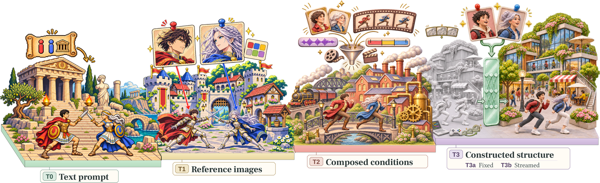

# Awesome Generative Renderers
### *Video Models as Generative Renderers: Foundations, Interfaces, Systems, and Beyond*

[](https://genrender-hub.github.io/) [](https://genrender-hub.github.io/#library) [](#tier-3b-streamed--stateful-renderers) [](#evaluation-benchmarks) [](mailto:xyli@se.cuhk.edu.hk)

A living, community-maintained research library and interactive companion accompanying the survey ***Video Models as Generative Renderers: Foundations, Interfaces, Systems, and Beyond*** (November 2026). Synthesizing **over 330 works** (`336` verified references) and comparing **68 representative systems** across tiers 1–3 (`26` pre-fixed T3a renderers, `24` causal/stateful T3b renderers, and `18` reference-conditioned T1–T2 systems).

🌐 **Interactive Survey Hub & Searchable Library:** [https://genrender-hub.github.io/](https://genrender-hub.github.io/)



## Core Framework: The Specification Ladder

Frontier video generation is shifting from open-ended content invention toward **faithful conditional rendering**: decisions about scene layout, identity, rules, and timing move upstream into external specifications, leaving the video model to preserve what is specified and synthesize omitted visual detail.

| Tier | Upstream Specification | Precision | Timing | Authority |
|---|---|---|---|---|
| **T0** | Text prompt / rewritten caption | Described | Input-dependent | Generator interprets |
| **T1** | Subject reference portraits + text | Exemplified | Input-dependent | Generator interprets |
| **T2** | Multi-modal references & extracted controls | Exemplified / aligned | Input-dependent | Generator interprets |
| **T3a** | Externally constructed structure (clay, G-buffers, code, sim) | Frame-aligned | **Pre-fixed** before sampling | External clip specification |
| **T3b** | Externally constructed structure from live engine / agent | Frame-aligned | **Streamed** chunk by chunk | External evolving state |

> **Orthogonality note:** The **T3a vs. T3b** boundary is defined by *specification timing and causality* (whether $S_{1:T}$ is pre-fixed before sampling vs. causally driven by an evolving state), **not** wall-clock inference speed. A distilled pre-fixed clip renderer running faster than real-time remains T3a, whereas a causal stateful renderer running at 1 FPS remains T3b.

## Tier 3b: Streamed & Stateful Renderers (24 systems)

| System | Year | Settled Upstream | Renderer Inputs | Injection | RT / Speed |
|---|---|---|---|---|---|
| [FrameDiffuser](https://arxiv.org/abs/2512.16670) | 2025 | Geometry, materials, lighting | 9 G-buffer ch. + irradiance, prev. frame | ControlNet + LoRA | ≈1 FPS |
| [RealWonder](https://arxiv.org/abs/2603.05449) | 2026 | 3D forces, rigid/fluid physics | Sim. optical flow + coarse RGB, image | Flow concat. + LoRA | Yes (13 FPS) |
| [AlayaRenderer-Flash](https://arxiv.org/abs/2607.18703) | 2026 | Geometry, PBR materials | 5 G-buffers, switchable prompt | Channel concat. | Yes (32 FPS) |
| [Closing the Loop](https://arxiv.org/abs/2607.21848) | 2026 | Scene geometry, camera poses | Engine depth, camera poses, KV loop | Causal VACE + attn. bias | Yes |
| [Magpie](https://arxiv.org/abs/2608.27168) | 2026 | Layout, rules, state, motion | White-box RGB, init. frame + prompt | History x-attn. | Yes (1.55 s) |
| [Programmable WM](https://arxiv.org/abs/2609.10540) | 2026 | Entities, states, rules, camera | ID / sem. / dir. maps, cam., 1st frame | Spatial ControlNet | No |
| [LynnReal-Omni](https://arxiv.org/abs/2609.15863) | 2026 | Scene renders, multi-modal refs. | Typed 3D renders, image/audio refs., text | Typed H3 sequence | Flash var. |
| [CoDeR](https://arxiv.org/abs/2609.26458) | 2026 | Executable world rules & multi-agent | Whitebox Canny + depth, text, reg. obs. | ControlNet + LoRA (H3) | No |
| [AgentGarten](https://arxiv.org/abs/2610.12374) | 2026 | Scene program, interactive state | Depth or normals, ref. frame, text | In-context seq. concat. | Yes (>35 FPS) |
| [EdenLive](https://assets.vast-eden.ai/assets/edenlive/EdenLive-tech-report.pdf) | 2026 | Game state, layout, live events | Proxy as DINOv3 features, 1st frame, text | Feature ch. concat. | Yes (74 FPS) |
| [Mallea](https://arxiv.org/abs/2610.21283) | 2026 | Object rules, edits, user steering | Whitebox + depth/edges, obj. tex. mem. | NR | No |
| [Stateful Harness](https://arxiv.org/abs/2610.26811) | 2026 | Hidden state, combat/quest rules | 3D preview clip, 1st frame, compiled text | Frozen H3 video ref. | No |
| [Matrix-Game 4.0](https://arxiv.org/abs/2610.27999) | 2026 | Rules, state, layout, motion, cam. | Low-poly RGB, dyn. caption, mem. frames | 148-ch. patch concat. | Yes (83 FPS) |
| [DeXplicit](https://arxiv.org/abs/2610.30781) | 2026 | Hand actions → metric 3D state | Projected 3D point scaffold, history | Scaffold fusion (2-step) | Yes |
| [UniWorld](https://arxiv.org/abs/2610.32381) | 2026 | Rolling depth trajectory, edits | Windowed depth latents, ref. image, text | H3 ControlNet-Union | Yes (14+ FPS) |
| [BoxWorld](https://arxiv.org/abs/2610.36371) | 2026 | Object boxes, attributes, status | Per-frame 2D boxes + status tokens, text | Box-masked x-attn. | Yes (21 FPS) |
| [Wizard](https://arxiv.org/abs/2610.40339) | 2026 | Geometry, skeletons, combat state | Height/slot/depth proxy, char. refs. | Concat. + ref. + masks | Yes (24 FPS) |
| [Fight World Model](https://arxiv.org/abs/2610.40607) | 2026 | Hit resolution, HP, skill windows | Fighter boxes, action stripes, HP, refs. | Gated token concat. | No |
| [GSExplorer](https://arxiv.org/abs/2611.01543) | 2026 | Persistent SLAM-updated 3DGS | 3DGS multimodal renders + relative rays | Adapter + ray branch | No |
| [PlayGen2](https://arxiv.org/abs/2611.07867) | 2026 | Occupancy grid + entity 3D states | Projected depth, semantics, 4 RGB frames | Scene/history x-attn. | Yes (160 ms) |
| [StreamRender-H3](https://nvlabs.github.io/Sana/Sol-Engine/StreamRender-H3/) | 2026 | Track map, physics, racing rules | 13-class semantic stream, ref., narration | H3 ref. + DMD | Yes (8 GPUs) |
| [Streaming CWM](https://github.com/TingtingLiao/streaming-code-world-model) | 2026 | Driving state, layout, camera | CWM depth+semantic proxy, 1st frame | H3 ref. + LoRA | No (5.1 s) |
| [GameWM](https://arxiv.org/abs/2611.19247) | 2026 | Rules, state, layout, hit timing | DUV, depth, sem., capsule, sheet, 1st | H3 ref. / prefix + LoRA | Yes (13–18 FPS) |
| [Code World Model 2.0](https://arxiv.org/abs/2611.22925) | 2026 | Scene state, multi-gran. motion, cam. | Coarse/fine proxies, 1st frame, text | H3 ref. + ProForcing | Yes (18 FPS) |

## Tier 3a: Pre-Fixed Clip Generative Renderers (26 systems)

| System | Year | Settled Upstream | Renderer Inputs | Injection | RT / Variant |
|---|---|---|---|---|---|
| [Diffusion as Shader](https://arxiv.org/abs/2501.03847) | 2025 | 3D mesh, motion, camera | 3D point-tracking video, first frame | Channel concat. | No |
| [DiffusionRenderer](https://arxiv.org/abs/2501.18590) | 2025 | Geometry, PBR materials, light | 5 G-buffers, env. map | Concat. + light x-attn. | No |
| [Cosmos-Transfer1](https://arxiv.org/abs/2503.14492) | 2025 | Segmentation, depth, edges | Multi-modal control videos, text | Modality branches | No |
| [ControlHair](https://arxiv.org/abs/2509.21541) | 2025 | Strand physics, wind, motion | Simulated hair maps, portrait | Conv. + DiT LoRA | No |
| [X2Video](https://arxiv.org/abs/2510.08530) | 2025 | Geometry, PBR intrinsics, light | 5 intrinsic channels, ref. image, text | Input fusion + hybrid attn. | No |
| [VerseCrafter](https://arxiv.org/abs/2601.05138) | 2026 | Static cloud + 3DGS paths | Rendered 4D control maps, text | GeoAdapter branch | No |
| [Coarse-to-Real](https://arxiv.org/abs/2601.22301) | 2026 | Urban layout, trajectories | Coarse CG as DINOv3 features, text | Additive features | No |
| [RealMaster](https://arxiv.org/abs/2603.23462) | 2026 | Scene geometry, dynamics, IDs | Engine RGB render, text | IC-LoRA token concat. | No |
| [Gen. World Renderer](https://arxiv.org/abs/2604.02329) | 2026 | Geometry, surface materials | 5 G-buffers, text | Channel concat. | No |
| [DriveCtrl](https://arxiv.org/abs/2605.15116) | 2026 | Road layout, agent dynamics | Simulator depth, style ref., text | Dual-noise Fun-Control | No |
| [ProxyUp](https://arxiv.org/abs/2607.03732) | 2026 | Foreground physics / motion | Coarse proxy RGB + fg. mask, text | Training-free inv. | No |
| [LightCrafter](https://arxiv.org/abs/2607.08016) | 2026 | Relit PBR geometry & light | Relit PBR proxy video, text | Proxy latent fusion | No |
| [VideoCoCo](https://arxiv.org/abs/2607.27380) | 2026 | Physics-consistent 3D scene | Blender clay draft video, text | Draft video editor | No |
| [DAR](https://arxiv.org/abs/2608.00094) | 2026 | Animated mesh, camera path | Neural 4D G-buffer, Plucker rays, ref. | Widened cam. branch + LoRA | No |
| [RGBX-Next](https://arxiv.org/abs/2608.13929) | 2026 | Geometry, materials, irradiance | G-buffers, irradiance, text | Typed seq. concat. | Stream var. |
| [Code World Model](https://arxiv.org/abs/2608.25927) | 2026 | World state, rules, camera | Depth + semantic-ID proxy, anchor, text | H3 ref. + LoRA | No |
| [WorldWeave](https://arxiv.org/abs/2609.34221) | 2026 | Metric terrain, placed 3D assets | Queried metric depth + mask, style ref. | Depth adapter (H3) | No |
| [Proxy2World](https://arxiv.org/abs/2609.35023) | 2026 | Coarse layout, camera path | Proxy depth, camera, first frame | Hybrid early denoising | No |
| [GenCine](https://arxiv.org/abs/2610.02180) | 2026 | 3D handles, camera trajectory | Handle ID + 3D world-pos. maps, image | Guidance branch + LoRA | No |
| [Code Video Model](https://code-video-model.github.io/tech_report.pdf) | 2026 | Layout, motion, physics, camera | Three.js proxy video, ref. image | H3 early-step (25%), TF | No |
| [BodyBridge](https://arxiv.org/abs/2610.24436) | 2026 | Road geometry + articulated VRUs | Depth + SMPL correspondence + masks | Cosmos body branch | No |
| [SolarRenderer](https://arxiv.org/abs/2610.28630) | 2026 | Layout, geometry, bodies, camera | Any structural video, optional 1st frame | H3 ref. + r384 LoRA | Causal var. |
| [NeuralSRender](https://arxiv.org/abs/2610.29200) | 2026 | Driving geometry & materials | 5 G-buffers, weather/time text | Projector + 2-stage LoRA | No |
| [AnyGameRenderer](https://arxiv.org/abs/2610.31466) | 2026 | Entities, layout, game timing | Crude gameplay RGB, style ref., text | H3 ref. + LoRA | No |
| [Video-Coder](https://arxiv.org/abs/2611.09894) | 2026 | Multi-turn 3D scene & motion | Blender white-model draft video, text | Frozen H3 ref. pathway | No |
| [CoCode-World](https://arxiv.org/abs/2611.15602) | 2026 | Shared 3D scene, 2-player cams. & IDs | Paired 3D proxy videos, joint ref., text | H3 2-view ref. + LoRA | No |

## Tiers 1–2: Reference & Compositional Lineage (18 representative systems)

| System | Year | Settled Upstream | Renderer Inputs | Injection | RT / Speed |
|---|---|---|---|---|---|
| [CustomCrafter](https://arxiv.org/abs/2408.13239) | 2025 | Subject identity (T1) | Subject photos, prompt | Staged subject LoRA | No |
| [ConsisID](https://arxiv.org/abs/2411.17440) | 2024 | Human facial identity (T1) | Face reference + keypoints, prompt | Low/high-freq. adapters | No |
| [PersonalVideo](https://arxiv.org/abs/2411.17048) | 2024 | Human identity (T1) | ID portrait(s), prompt | Late-step ID adapter | No |
| [DreamVideo-2](https://arxiv.org/abs/2410.13830) | 2024 | Subject + box trajectory (T1/T2) | Subject image, 2D box masks, prompt | Box-masked ref. attn. | No |
| [Movie Weaver](https://arxiv.org/abs/2502.07802) | 2025 | Multi-concept cast (T2) | Face/body/animal refs., anchored text | Concept anchor tokens | No |
| [Phantom](https://arxiv.org/abs/2502.11079) | 2025 | Single/multi-subject look (T1/T2) | Reference images, prompt | MMDiT window concat. | No |
| [CINEMA](https://arxiv.org/abs/2503.10391) | 2025 | Multi-subject cast & roles (T2) | 1–6 RGBA entity images, prompt | MLLM-guided conditioning | No |
| [Concat-ID](https://arxiv.org/abs/2503.14151) | 2025 | Single/multi-identity (T1/T2) | VAE-encoded face images, prompt | 3D self-attn. seq. concat. | No |
| [SkyReels-A2](https://arxiv.org/abs/2504.02436) | 2025 | Characters, props, bg. (T2) | Multi-element images, prompt | Joint image-text embed. | No |
| [HunyuanCustom](https://arxiv.org/abs/2505.04512) | 2025 | Subject + audio/video cues (T2) | Ref. images, audio, driving video, text | LLaVA + AudioNet + patch | No |
| [MAGREF](https://arxiv.org/abs/2505.23742) | 2025 | Multi-subject appearance (T2) | Region-masked subject refs., prompt | Masked ch. concat. | No |
| [TalkingMachines](https://arxiv.org/abs/2506.03099) | 2025 | Live dialogue audio (T2) | Portrait image, streaming speech audio | Local-window audio x-attn. | Yes |
| [OmniHuman-1.5](https://arxiv.org/abs/2508.19209) | 2025 | Script & gesture plan (T2) | Portrait, speech audio, MLLM plan | MMDiT audio/ref. branches | No |
| [Kling-Avatar](https://arxiv.org/abs/2509.09595) | 2025 | Multimodal shot blueprint (T2) | Portrait, Whisper audio, blueprint | Audio x-attn. + blueprint | No |
| [BindWeave](https://arxiv.org/abs/2510.00438) | 2026 | Subjects, roles, relations (T2) | Subject images, relational prompt | Qwen2.5-VL → DiT MLP | No |
| [Kaleido](https://arxiv.org/abs/2510.18573) | 2025 | Multi-subject appearance (T2) | Multiple subject images, prompt | Reference RoPE (R-RoPE) | No |
| [Kling-Omni](https://arxiv.org/abs/2512.16776) | 2025 | Multimodal context (T2) | Text, images, video references | Shifted-window asym. attn. | No |
| [Custom Forcing](https://arxiv.org/abs/2610.02914) | 2026 | Streaming subject identity (T1) | 5 subject anchor images, prompt | Persistent KV + DVA/ACG | Yes |

## Evaluation Benchmarks (30 benchmarks across 3 pipeline stages)

| Benchmark | Stage | Reference / Oracle | Breakdown | Cases |
|---|---|---|---|---|
| [Code2Video-Compass](https://arxiv.org/abs/2610.28416) | Stage 1: Specification Construction | Checklist; inputs | 3 tasks | 2,104 |
| [3DCodeBench](https://arxiv.org/abs/2606.01057) | Stage 1: Specification Construction | GT mesh, renders | 2 tracks | 212 |
| [Code4Scene](https://arxiv.org/abs/2609.36777) | Stage 1: Specification Construction | Checklist; GT | 2 tasks | 170 |
| [4DCodeBench](https://arxiv.org/abs/2610.03715) | Stage 1: Specification Construction | Video; 4D GT | 2 sets | 200 |
| [BVB](https://arxiv.org/abs/2609.15478) | Stage 1: Specification Construction | Video and its QA | 1 task | 288 |
| [CodeCap-Bench](https://arxiv.org/abs/2610.37341) | Stage 1: Specification Construction | Video, focal points | 5 cat. | 323 |
| [CineRecon](https://arxiv.org/abs/2610.16577) | Stage 1: Specification Construction | Video; checklists | 3 settings | 360 |
| [VibePrevisBench](https://arxiv.org/abs/2611.15789) | Stage 1: Specification Construction | Hidden scene facts | 4 briefs | 242 |
| [PROWBench](https://arxiv.org/abs/2610.02205) | Stage 2: Rendering | Engine log | 5 subsets | 170 |
| [WorldDraft](https://arxiv.org/abs/2611.16217) | Stage 2: Rendering | Sim. state; prompt | 48 worlds | 432 |
| [ProxyGenBench](https://arxiv.org/abs/2611.34457) | Stage 2: Rendering | Checklists; inputs | 3 tasks | 312 |
| [RenderBench](https://arxiv.org/abs/2610.08684) | Stage 2: Rendering | Real target video | 2 tracks | 12 |
| [ProxyBench](https://arxiv.org/abs/2609.35023) | Stage 2: Rendering | Input path; proxy | – | 300 |
| [OmniVBench](https://arxiv.org/abs/2609.22069) | Stage 2: Rendering | Ref. checklists | 7 families | 813 |
| [PAI-Bench-C](https://arxiv.org/abs/2512.01989) | Stage 2: Rendering | Source controls | 5 controls | 600 |
| [WYD](https://arxiv.org/abs/2503.04666) | Stage 2: Rendering | Video, mask, pose | 9 cat. | 1,544 |
| [VBench](https://arxiv.org/abs/2311.17982) | Stage 3: Final Video / System | Prompt and labels | 16 dims | ~100 |
| [VBench-2.0](https://arxiv.org/abs/2503.21755) | Stage 3: Final Video / System | Expected outcomes | 18 dims | ~70 |
| [WorldScore](https://arxiv.org/abs/2504.00983) | Stage 3: Final Video / System | Input path, objects | 2 types | 3,000 |
| [Orbia](https://arxiv.org/abs/2610.20693) | Stage 3: Final Video / System | RGB-D; first visit | 2 lengths | 720 |
| [StrideWorld](https://arxiv.org/abs/2611.24408) | Stage 3: Final Video / System | GT depth; stride | 6 actions | 140 |
| [GAUGE](https://arxiv.org/abs/2608.05948) | Stage 3: Final Video / System | Real trajectories | 5 tasks | 9 |
| [RigidBench](https://arxiv.org/abs/2608.15555) | Stage 3: Final Video / System | Simulator rollout | 5 tasks | 100 |
| [WMEval](https://arxiv.org/abs/2610.33894) | Stage 3: Final Video / System | Unity rollout, logs | 6 dims | 9 |
| [StreamEval](https://arxiv.org/abs/2610.28402) | Stage 3: Final Video / System | Checkpoint oracles | 5 tasks | 300 |
| [WBench](https://arxiv.org/abs/2605.25874) | Stage 3: Final Video / System | Path; first frame | 4 types | 289 |
| [WorldMark](https://arxiv.org/abs/2604.21686) | Stage 3: Final Video / System | Flow; past frames | 2 views | 500 |
| [PlayWorld](https://arxiv.org/abs/2608.13552) | Stage 3: Final Video / System | Yes/no rubric | – | 171 |
| [StateBench](https://arxiv.org/abs/2609.03673) | Stage 3: Final Video / System | Annotated state | 3 types | 200 |
| [Visual Shell Game](https://arxiv.org/abs/2608.30692) | Stage 3: Final Video / System | Simulated ball | – | 64 |

## Contributing

Want to add a new generative renderer, proxy benchmark, or streaming system? Open a Pull Request editing `docs/data/catalog.json` (or run `python3 scripts/sync_from_survey.py` against updated LaTeX tables) with the verified arXiv link, tier placement, and BibTeX entry, or email [xyli@se.cuhk.edu.hk](mailto:xyli@se.cuhk.edu.hk).

## Citation

```bibtex
@article{li2026generativerenderers,
  title   = {Video Models as Generative Renderers: Foundations, Interfaces, Systems, and Beyond},
  author  = {Li, Xinye and Zhang, Liuzhou and Sun, Te and Luo, Shipeng and Lin, Lingshuai and Jin, Yijie and Lang, Zirui and Fang, Guian and others and Wu, Shu and Huang, Yan and Zhang, Shaofeng and Ding, Fangqiang and Lam, Wai},
  journal = {arXiv preprint},
  year    = {2026}
}
```
